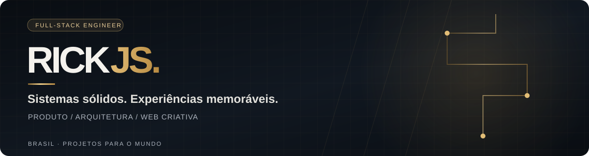
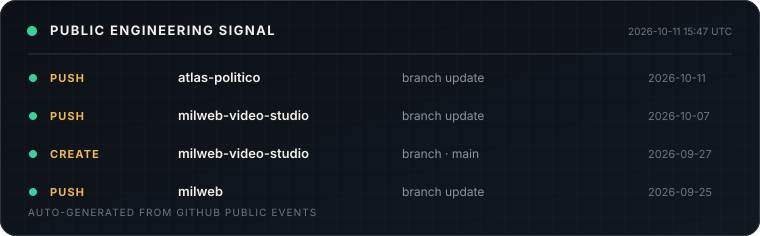

[Português](README.pt-BR.md) · **English**

 

**Full-stack developer · founder of [MilWeb](https://milweb.com.br)**

I build digital products end to end: domain model, API, interface and experience.

 

[Portfolio — milweb.com.br](https://milweb.com.br) · [Featured work](#featured-work) · [LinkedIn](https://www.linkedin.com/in/rick-januario-41211b238/)

---

### What I build

<table>
<tr>
<td width="50%" valign="top">

**01 / Products and platforms**

Web applications with real business rules: domain modeling, APIs, data, authentication, background jobs and real-time features.

</td>
<td width="50%" valign="top">

**02 / Web that stands out**

Websites and experiences with visual direction, motion, 3D and attention to performance. Interface and engineering go together, from concept to deploy.

</td>
</tr>
</table>

`TypeScript` · `Next.js` · `React` · `Node.js` · `PostgreSQL` · `Prisma` · `Redis` · `Three.js / React Three Fiber` · `GSAP` · `Tailwind CSS` · `Expo`

## Featured work

<table>
<tr>
<td width="50%" valign="top">

### [MilWeb ↗](https://milweb.com.br)
**My studio and portfolio**

Studio website in Portuguese, English and Spanish, with a 3D hero, scroll animation and the project portfolio.

`Next.js` `React Three Fiber` `GSAP` `Lenis` `Tailwind CSS`

[Website →](https://milweb.com.br) · [Code →](https://github.com/rickjs2005/milweb)

</td>
<td width="50%" valign="top">

### [InkVision ↗](https://github.com/rickjs2005/inkvision)
**Multi-tenant SaaS for tattoo studios**

Artist discovery, quotes, real-time chat, AI tattoo simulation, scheduling and payments, organized in layers (web, realtime and worker apps). In development; no production deployment yet.

`Next.js` `Prisma` `PostgreSQL` `Redis` `Socket.IO` `BullMQ`

[Code →](https://github.com/rickjs2005/inkvision)

</td>
</tr>
<tr>
<td width="50%" valign="top">

### [Aurex Motors ↗](https://aurex-motors-ecru.vercel.app)
**Cinematic site for a fictional EV brand**

Scroll-driven 3D scenes, scripted camera and a real-time car configurator. Fictional brand; 3D model credited in the project.

`Next.js` `React Three Fiber` `GSAP` `Lenis`

[Demo →](https://aurex-motors-ecru.vercel.app) · [Code →](https://github.com/rickjs2005/aurex-motors)

</td>
<td width="50%" valign="top">

### [Lumen Architecture ↗](https://lumen-architecture-drab.vercel.app)
**One-page site for a fictional architecture studio**

Scroll-driven procedural 3D house, interactive scene and project gallery, with unit and end-to-end tests.

`Vite` `React` `React Three Fiber` `GSAP` `Vitest` `Playwright`

[Demo →](https://lumen-architecture-drab.vercel.app) · [Code →](https://github.com/rickjs2005/lumen-architecture)

</td>
</tr>
<tr>
<td width="50%" valign="top">

### [Terral ↗](https://terral-cafe.vercel.app)
**Concept for a fictional coffee roastery**

From mountain to cup: a five-chapter scroll journey with a real-time 3D coffee bean and horizontal panels.

`Next.js` `React Three Fiber` `GSAP` `Lenis` `Tailwind CSS`

[Demo →](https://terral-cafe.vercel.app) · [Code →](https://github.com/rickjs2005/terral)

</td>
<td width="50%" valign="top">

### [Aurex Timepieces ↗](https://aurex-timepieces.vercel.app)
**Concept for a fictional watch brand**

A fully procedural Three.js watch that disassembles and reassembles on scroll, with a case/dial/hands configurator.

`Next.js` `React Three Fiber` `GSAP` `Lenis`

[Demo →](https://aurex-timepieces.vercel.app) · [Code →](https://github.com/rickjs2005/aurex-timepieces)

</td>
</tr>
</table>

## More projects

| Project | What it is | Links |
| :--- | :--- | :--- |
| **Atelier Vertex** | Fictional architecture studio; scrolling scrubs a full-screen construction video (Next.js, GSAP ScrollTrigger, Lenis) | [Demo](https://atelier-vertex-v2.vercel.app) · [Code](https://github.com/rickjs2005/atelier-vertex-v2) |
| **RJS Laticínios** | Fictional dairy brand: interactive SVG mascot, flavor-based theming and 3D product views (Next.js, SCSS Modules, GSAP, React Three Fiber) | [Demo](https://rjs-laticinios.vercel.app) · [Code](https://github.com/rickjs2005/rjs-laticinios) |
| **Copa 2026** | Fan-made, unofficial editorial site about World Cup history with stadiums recreated in 3D; not affiliated with FIFA (Next.js, React Three Fiber) | [Demo](https://copa2026-alpha.vercel.app) · [Code](https://github.com/rickjs2005/copa2026) |
| **RockVerse** | Fan-made, non-commercial concept site about the history of rock; not affiliated with any artist or label (Next.js, Framer Motion) | [Code](https://github.com/rickjs2005/rockverse) |
| **Império do Café** | Offline coffee-farming management game for iOS/Android, in development and not on app stores (Expo, React Native) | [Code](https://github.com/rickjs2005/rpg-mobile) |
| **MilWeb Video Studio** | Claude Code skill (pt-BR) for social content and video production, with a tested Python media-audit script | [Code](https://github.com/rickjs2005/milweb-video-studio) |

## Public activity

Updated automatically from public GitHub events; it does not reflect work in private repositories.

<!--START_SECTION:activity-->
- `CREATE` [panico-de-estado](https://github.com/rickjs2005/panico-de-estado) — branch · claude/sleepy-meitner-xy8cuu · 2026-10-12
- `PUSH` [atlas-politico](https://github.com/rickjs2005/atlas-politico) — branch update · 2026-10-12
- `CREATE` [atlas-politico](https://github.com/rickjs2005/atlas-politico) — branch · main · 2026-10-10
- `PUSH` [milweb-video-studio](https://github.com/rickjs2005/milweb-video-studio) — branch update · 2026-10-07
- `CREATE` [milweb-video-studio](https://github.com/rickjs2005/milweb-video-studio) — branch · main · 2026-09-27
<!--END_SECTION:activity-->

---

**Have a project in mind?** [See my work and get in touch through MilWeb ↗](https://milweb.com.br)

Build, measure, learn, simplify.

The activity section is refreshed by `.github/workflows/update-profile.yml` (`scripts/update-profile.mjs`). No license has been chosen yet; all rights reserved by the author.

