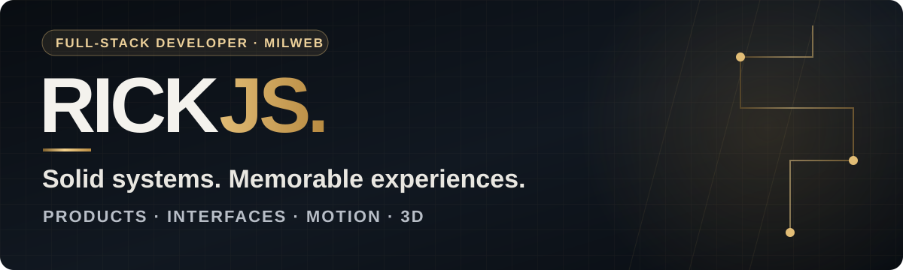

[Português](README.pt-BR.md) · **English**

**Full-stack developer · founder of [MilWeb](https://milweb.com.br)**

I build web products end to end — data, APIs and interfaces — with a focus on premium interfaces, motion and real-time 3D.

[Portfolio — milweb.com.br](https://milweb.com.br) · [LinkedIn](https://www.linkedin.com/in/rick-januario-41211b238/) · [Featured work](#featured-work)

### What I build

- **Products and platforms** — business rules, APIs, authentication, data and real-time features.
- **Visual web experiences** — art direction, scroll animation and 3D, with attention to performance.

`TypeScript` · `Next.js` · `React` · `Node.js` · `PostgreSQL` · `Three.js` · `GSAP`

## Featured work

<table>
<tr>
<td width="50%" valign="top">

<h3>MilWeb</h3>

My studio’s website and portfolio, in Portuguese, English and Spanish, with a 3D globe hero and scroll-driven sections.

<code>Next.js</code> <code>React Three Fiber</code> <code>GSAP</code> <code>Tailwind CSS</code>

<a href="https://milweb.com.br">Website ↗</a> · <a href="https://github.com/rickjs2005/milweb">Code ↗</a>

</td>
<td width="50%" valign="top">

<h3>InkVision</h3>

Multi-tenant SaaS for tattoo studios: artist discovery, quotes, real-time chat, a preview of the tattoo on the client’s photo and scheduling. In development; payments, storage and AI run on simulated providers by default.

<code>Next.js</code> <code>PostgreSQL</code> <code>Socket.IO</code> <code>BullMQ</code>

<a href="https://github.com/rickjs2005/inkvision">Code ↗</a>

</td>
</tr>
<tr>
<td width="50%" valign="top">

<h3>Aurex Motors</h3>

Cinematic site for a fictional electric-car brand: scroll-driven 3D scenes and a real-time car configurator.

<code>Next.js</code> <code>React Three Fiber</code> <code>GSAP</code> <code>Lenis</code>

<a href="https://aurex-motors-ecru.vercel.app">Demo ↗</a> · <a href="https://github.com/rickjs2005/aurex-motors">Code ↗</a>

</td>
<td width="50%" valign="top">

<h3>Lumen Architecture</h3>

Site for a fictional architecture studio: a code-generated 3D house the camera moves through as you scroll.

<code>React</code> <code>React Three Fiber</code> <code>GSAP</code> <code>Playwright</code>

<a href="https://lumen-architecture-drab.vercel.app">Demo ↗</a> · <a href="https://github.com/rickjs2005/lumen-architecture">Code ↗</a>

</td>
</tr>
<tr>
<td width="50%" valign="top">

<h3>Terral</h3>

Concept for a fictional coffee roastery: a five-chapter scroll journey with a real-time 3D coffee bean.

<code>Next.js</code> <code>React Three Fiber</code> <code>GSAP</code> <code>Lenis</code>

<a href="https://terral-cafe.vercel.app">Demo ↗</a> · <a href="https://github.com/rickjs2005/terral">Code ↗</a>

</td>
<td width="50%" valign="top">

<h3>Aurex Timepieces</h3>

Concept for a fictional watch brand: a procedural Three.js watch that comes apart on scroll, with a case, dial and hands configurator.

<code>Next.js</code> <code>React Three Fiber</code> <code>GSAP</code> <code>Lenis</code>

<a href="https://aurex-timepieces.vercel.app">Demo ↗</a> · <a href="https://github.com/rickjs2005/aurex-timepieces">Code ↗</a>

</td>
</tr>
</table>

## Recent updates

- **Sep 2026 · MilWeb** — new home page direction: orbital opening, editorial project gallery with real captures and an accessible mobile menu. ([commit](https://github.com/rickjs2005/milweb/commit/df4aed976f614c0061348372ce289b311bd7eeb1))
- **Sep 2026 · MilWeb** — “MilWeb System”: one registry for every section of the site and an on-screen HUD that shows real device readings (viewport, pixel ratio, pointer, reduced motion). ([commit](https://github.com/rickjs2005/milweb/commit/7cffe5c35a59f84033b52be88ed103b3dd09a918))

## More projects

- [Atelier Vertex](https://github.com/rickjs2005/atelier-vertex-v2) — fictional architecture studio; scrolling scrubs a construction film.
- [RJS Laticínios](https://github.com/rickjs2005/rjs-laticinios) — fictional dairy brand with an interactive SVG mascot and 3D product views.
- [Império do Café](https://github.com/rickjs2005/rpg-mobile) — offline coffee-farming game for iOS and Android (Expo), in development.

[All public repositories →](https://github.com/rickjs2005?tab=repositories)

---

**Have a project in mind?** [Meet MilWeb and let’s talk ↗](https://milweb.com.br)

No license has been chosen for this repository; all rights reserved.

