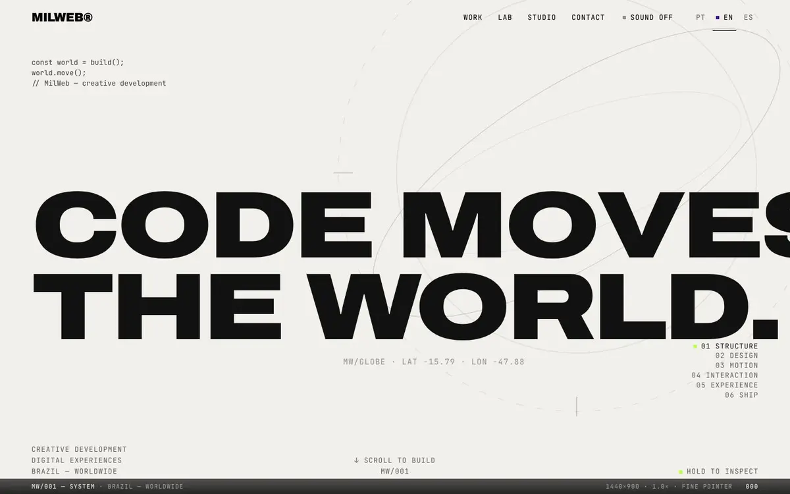
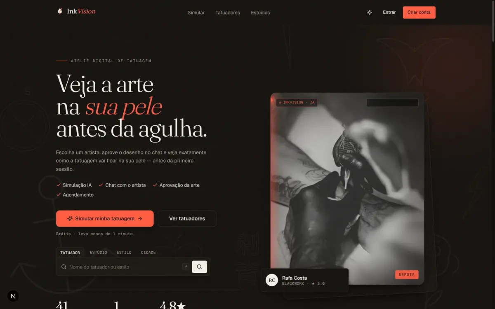
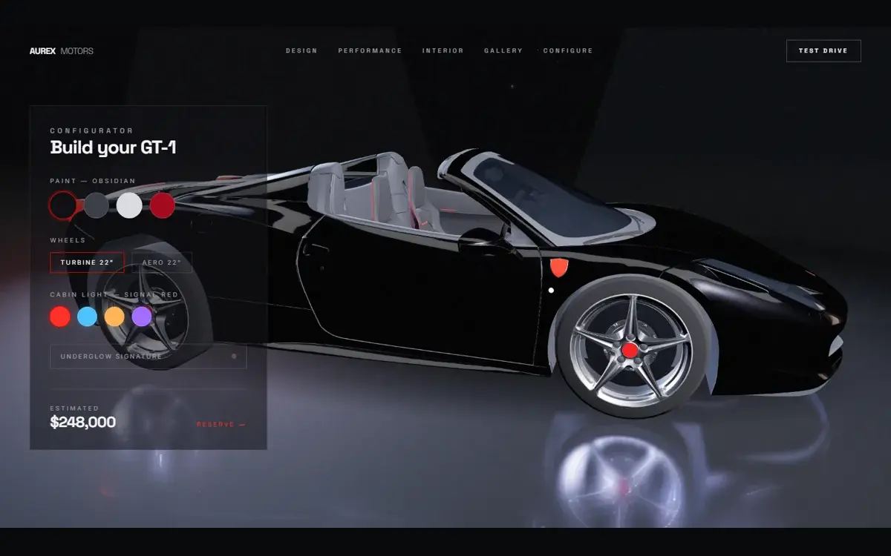
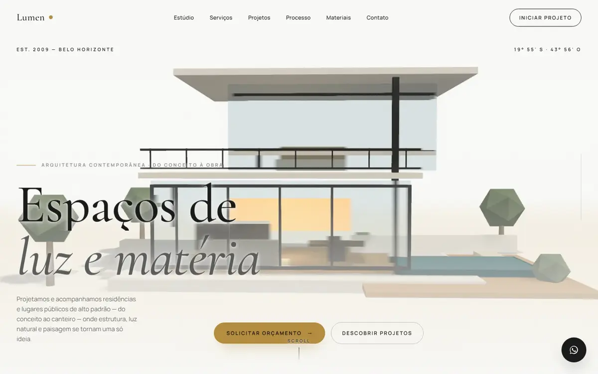
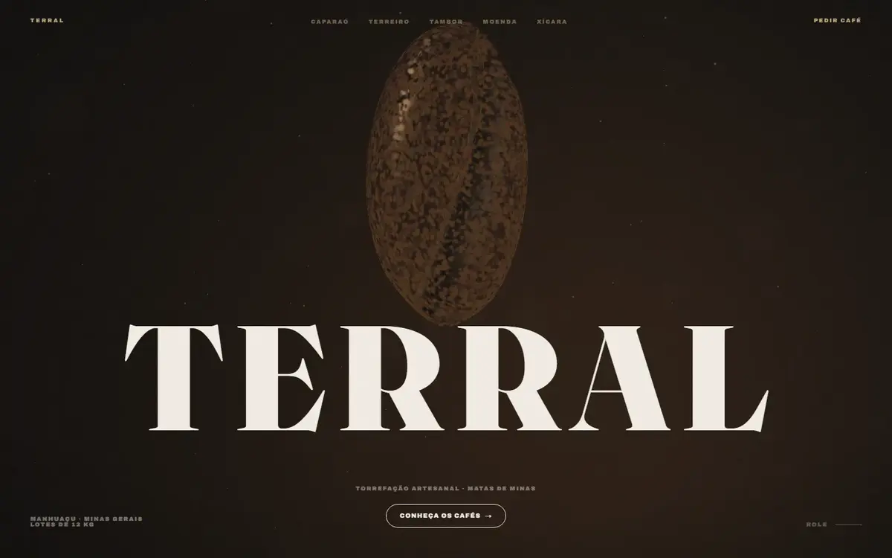
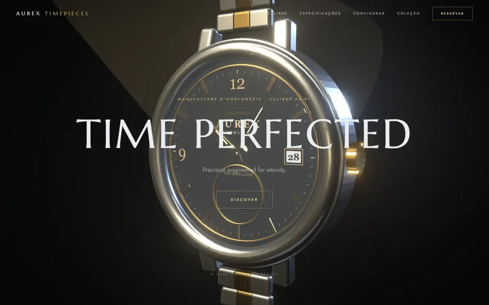

**Português** · [English](README.md)

**Desenvolvedor full-stack · fundador da [MilWeb](https://milweb.com.br)**

Desenvolvo produtos web de ponta a ponta — dados, APIs e interfaces — com foco em interfaces premium, animação e 3D em tempo real.

[Portfólio — milweb.com.br](https://milweb.com.br) · [LinkedIn](https://www.linkedin.com/in/rick-januario-41211b238/) · [Projetos em destaque](#projetos-em-destaque)

### O que eu desenvolvo

- **Produtos e plataformas** — regras de negócio, APIs, autenticação, dados e recursos em tempo real.
- **Experiências web visuais** — direção de arte, animação no scroll e 3D, com atenção à performance.

`TypeScript` · `Next.js` · `React` · `Node.js` · `PostgreSQL` · `Three.js` · `GSAP`

## Projetos em destaque

<table>
<tr>
<td width="50%" valign="top">

<h3>MilWeb</h3>

Site e portfólio do meu estúdio, em português, inglês e espanhol, com hero em 3D com globo e seções guiadas pelo scroll.

<code>Next.js</code> <code>React Three Fiber</code> <code>GSAP</code> <code>Tailwind CSS</code>

<a href="https://milweb.com.br">Site ↗</a> · <a href="https://github.com/rickjs2005/milweb">Código ↗</a>

</td>
<td width="50%" valign="top">

<h3>InkVision</h3>

SaaS multi-tenant para estúdios de tatuagem: busca de artistas, orçamentos, chat em tempo real, prévia da tatuagem na foto do cliente e agendamento. Em desenvolvimento; pagamentos, armazenamento e IA usam provedores simulados por padrão.

<code>Next.js</code> <code>PostgreSQL</code> <code>Socket.IO</code> <code>BullMQ</code>

<a href="https://github.com/rickjs2005/inkvision">Código ↗</a>

</td>
</tr>
<tr>
<td width="50%" valign="top">

<h3>Aurex Motors</h3>

Site cinematográfico para uma marca fictícia de carros elétricos: cenas 3D guiadas pelo scroll e configurador do carro em tempo real.

<code>Next.js</code> <code>React Three Fiber</code> <code>GSAP</code> <code>Lenis</code>

<a href="https://aurex-motors-ecru.vercel.app">Demo ↗</a> · <a href="https://github.com/rickjs2005/aurex-motors">Código ↗</a>

</td>
<td width="50%" valign="top">

<h3>Lumen Architecture</h3>

Site para um escritório de arquitetura fictício: uma casa 3D gerada por código, que a câmera percorre conforme o scroll.

<code>React</code> <code>React Three Fiber</code> <code>GSAP</code> <code>Playwright</code>

<a href="https://lumen-architecture-drab.vercel.app">Demo ↗</a> · <a href="https://github.com/rickjs2005/lumen-architecture">Código ↗</a>

</td>
</tr>
<tr>
<td width="50%" valign="top">

<h3>Terral</h3>

Conceito para uma torrefação fictícia: uma jornada em cinco capítulos no scroll, com um grão de café em 3D em tempo real.

<code>Next.js</code> <code>React Three Fiber</code> <code>GSAP</code> <code>Lenis</code>

<a href="https://terral-cafe.vercel.app">Demo ↗</a> · <a href="https://github.com/rickjs2005/terral">Código ↗</a>

</td>
<td width="50%" valign="top">

<h3>Aurex Timepieces</h3>

Conceito para uma marca fictícia de relógios: um relógio procedural em Three.js que se desmonta no scroll, com configurador de caixa, mostrador e ponteiros.

<code>Next.js</code> <code>React Three Fiber</code> <code>GSAP</code> <code>Lenis</code>

<a href="https://aurex-timepieces.vercel.app">Demo ↗</a> · <a href="https://github.com/rickjs2005/aurex-timepieces">Código ↗</a>

</td>
</tr>
</table>

## Atualizações recentes

- **Set 2026 · MilWeb** — nova direção da página inicial: abertura orbital, galeria editorial de projetos com capturas reais e menu mobile acessível. ([commit](https://github.com/rickjs2005/milweb/commit/df4aed976f614c0061348372ce289b311bd7eeb1))
- **Set 2026 · MilWeb** — “MilWeb System”: um registro único para todas as seções do site e um HUD na tela que mostra leituras reais do dispositivo (viewport, densidade de pixels, ponteiro, movimento reduzido). ([commit](https://github.com/rickjs2005/milweb/commit/7cffe5c35a59f84033b52be88ed103b3dd09a918))

## Mais projetos

- [Atelier Vertex](https://github.com/rickjs2005/atelier-vertex-v2) — escritório de arquitetura fictício; o scroll conduz um filme da construção.
- [RJS Laticínios](https://github.com/rickjs2005/rjs-laticinios) — marca fictícia de laticínios com mascote SVG interativo e produtos em 3D.
- [Império do Café](https://github.com/rickjs2005/rpg-mobile) — jogo offline de gestão de fazenda de café para iOS e Android (Expo), em desenvolvimento.

[Todos os repositórios públicos →](https://github.com/rickjs2005?tab=repositories)

---

**Tem um projeto em mente?** [Conheça a MilWeb e vamos conversar ↗](https://milweb.com.br)

Este repositório ainda não tem licença definida; todos os direitos reservados.

